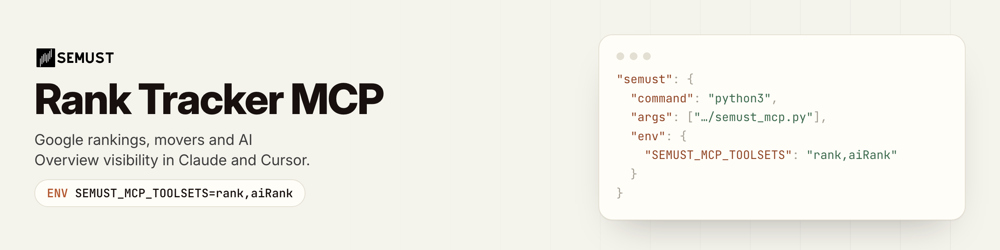
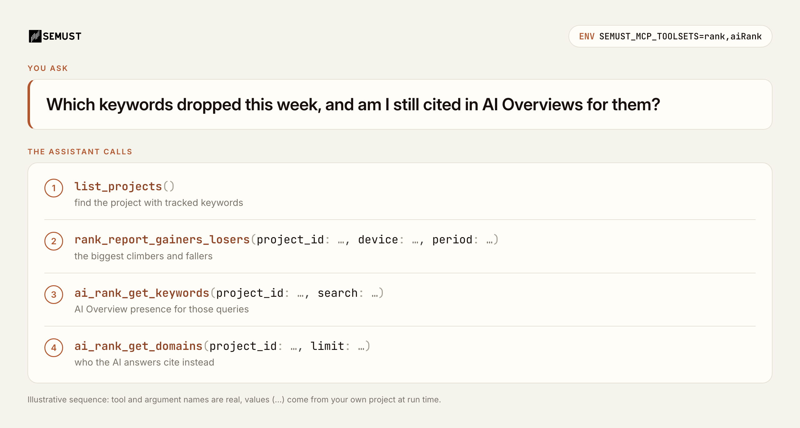
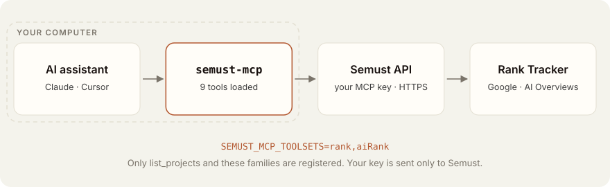

# Rank Tracker MCP Server

[](https://semust.com/en/features/mcp/rank-tracker-mcp?utm_source=github&utm_medium=referral&utm_campaign=rank-tracker-mcp&utm_content=banner)

[](https://app.semust.com/settings?tab=mcp&utm_source=github&utm_medium=referral&utm_campaign=rank-tracker-mcp&utm_content=badge)
[](https://semust.com/en/docs/mcp/tools/rank-tracker?utm_source=github&utm_medium=referral&utm_campaign=rank-tracker-mcp&utm_content=badge)
[](https://github.com/Semust-com/semust-mcp)
[](LICENSE)

The [Rank Tracker MCP server](https://semust.com/en/features/mcp/rank-tracker-mcp?utm_source=github&utm_medium=referral&utm_campaign=rank-tracker-mcp&utm_content=intro) opens your Semust-tracked Google rankings to Claude, Claude Code and Cursor. Ask where your keywords rank, which ones moved this week and how your positions are distributed, and get a straight answer instead of scrolling a ranking table.

The same server watches Google's AI answers. You can hold page one while the AI Overview above you cites other sites; the AI Overview tools show how often you are cited, for which queries, and which domains are cited instead. It is part of [Semust](https://semust.com/en?utm_source=github&utm_medium=referral&utm_campaign=rank-tracker-mcp&utm_content=intro), the SEO and analytics platform behind the data.

> [!NOTE]
> This repository contains no server code. It is a ready-made setup for the open-source [Semust MCP server](https://github.com/Semust-com/semust-mcp) that loads only the 9 tools you need here, with `SEMUST_MCP_TOOLSETS=rank,aiRank`. Copy a config from [`configs/`](configs), add your key and path, and restart your client.

- [What you can ask](#what-you-can-ask)
- [How it works](#how-it-works)
- [Setup](#setup)
- [Tools in this server](#tools-in-this-server)
- [Requirements](#requirements)
- [Security](#security)
- [Troubleshooting](#troubleshooting)
- [FAQ](#faq)
- [Learn more](#learn-more)

## What you can ask

Type these as they are or in your own words. The assistant picks the tool itself.

- Give me my ranking overview: visibility score, average position, yesterday's changes.
- List the 15 keywords that lost the most positions in 30 days.
- How many keywords are in the top three, and how many in 11–20?
- How has my average position changed over 90 days? Any clear break?
- Show desktop rankings for keywords containing "price".
- For how many tracked queries am I cited in an AI Overview?
- Which domains get cited in AI Overviews more often than mine?
- List keywords that don't rank at all. Where should I start?

[`prompts.md`](prompts.md) has 15 copy-paste prompts, grouped by task.



## How it works

<picture>
  <source media="(prefers-color-scheme: dark)" srcset="images/how-it-works-dark.svg">
  
</picture>

Your assistant talks to the Semust MCP server on your computer. With `SEMUST_MCP_TOOLSETS=rank,aiRank` the server registers 9 tools: `list_projects`, five Rank Tracker tools and three AI Overview Tracker tools. Each call goes to the Semust API with your MCP key, and Semust answers from the keywords you track there.

## Setup

Setup takes about five minutes: create a key, download the server once, then paste one config.

### 1. Create an MCP key

Log in to Semust and open [Settings → MCP Setup](https://app.semust.com/settings?tab=mcp&utm_source=github&utm_medium=referral&utm_campaign=rank-tracker-mcp&utm_content=setup). Create an **MCP key**: it starts with `smk_` and is shown only once, so copy it straight away. A key can reach all your projects or just one, expires after 30, 90 or 365 days, and can be renewed or revoked on the same page.

Leave **"Can post to social media"** switched off. The tools in this server only read data, and a read-only key is all they need.

### 2. Install the Semust MCP server

This repository holds the setup, not the server. Download the open-source [Semust MCP server](https://github.com/Semust-com/semust-mcp) once and install its three dependencies:

```bash
git clone https://github.com/Semust-com/semust-mcp.git
cd semust-mcp
pip install -r requirements.txt   # use pip3 if pip is not found
pwd                               # prints the folder; the config below needs its absolute path
```

Prefer a virtual environment? Run `python3 -m venv .venv && .venv/bin/pip install -r requirements.txt` instead, and use `/absolute/path/to/semust-mcp/.venv/bin/python` as the `command` in the configs below. Your server then keeps working whatever happens to your system Python.

> [!IMPORTANT]
> `SEMUST_MCP_TOOLSETS` needs semust-mcp **1.9.0 or newer**. An older copy ignores it and loads every tool, so run `git pull` in the `semust-mcp` folder if you installed it before.

### 3. Add it to your AI client

| Client | Ready-made file |
| --- | --- |
| Claude Desktop | [`configs/claude_desktop_config.json`](configs/claude_desktop_config.json) |
| Claude Code | [`configs/claude-code.sh`](configs/claude-code.sh) |
| Cursor | [`configs/cursor-mcp.json`](configs/cursor-mcp.json) |

In each, replace `your-api-key-here` with your MCP key and `/absolute/path/to/semust-mcp/semust_mcp.py` with the real path from step 2.

#### Claude Desktop

Add this to `claude_desktop_config.json` ([full guide](https://semust.com/en/docs/mcp/setup/claude-desktop?utm_source=github&utm_medium=referral&utm_campaign=rank-tracker-mcp&utm_content=setup)):

```json
{
  "mcpServers": {
    "semust": {
      "command": "python3",
      "args": [
        "/absolute/path/to/semust-mcp/semust_mcp.py"
      ],
      "env": {
        "SEMUST_API_KEY": "your-api-key-here",
        "SEMUST_MCP_TOOLSETS": "rank,aiRank"
      }
    }
  }
}
```

<details>
<summary><b>Where is <code>claude_desktop_config.json</code>?</b></summary>

| System | Folder |
| --- | --- |
| macOS | `~/Library/Application Support/Claude/` (Finder → <kbd>Cmd</kbd>+<kbd>Shift</kbd>+<kbd>G</kbd>) |
| Windows | `%APPDATA%\Claude\` |
| Windows (Microsoft Store) | `%LOCALAPPDATA%\Packages\Claude_pzs8sxrjxfjjc\LocalCache\Roaming\Claude\` |

If the file is not there yet, create it. If it already has other servers, add the `"semust"` entry inside the existing `"mcpServers"` object instead of pasting a second one.
</details>

<details>
<summary><b>Windows, or <code>python3</code> not found?</b></summary>

- The path in `args` must be **absolute**. Claude Desktop does not expand `~`.
- On Windows use `"command": "python"` and a path with double backslashes, such as `"C:\\Users\\you\\semust-mcp\\semust_mcp.py"`. If `python` is not recognised, give the full path to `python.exe`.
- On macOS and Linux there is often no `python`, only `python3`. Run `which python3` and use the full path it prints if the server does not start.
</details>

You do not need `SEMUST_BASE_URL`: the server already points at the Semust API.

**Restart the client completely** after editing the file. On macOS press <kbd>Cmd</kbd>+<kbd>Q</kbd>; on Windows quit from the system tray icon. Closing the window is not enough.

#### Claude Code

Claude Code registers servers from the command line, so there is no file to edit:

```bash
claude mcp add --scope user semust \
  -e SEMUST_API_KEY=your-api-key-here \
  -e SEMUST_MCP_TOOLSETS=rank,aiRank \
  -- python3 /absolute/path/to/semust-mcp/semust_mcp.py
```

`--scope user` makes the server available in every project. To keep the key out of your shell history, put `SEMUST_API_KEY` and `SEMUST_MCP_TOOLSETS` in a `.env` file next to `semust_mcp.py` instead and leave out the `-e` flags; the server reads that file on startup.

#### Cursor

Copy the contents of [`configs/cursor-mcp.json`](configs/cursor-mcp.json) into `~/.cursor/mcp.json` to use the server in every project, or into `.cursor/mcp.json` inside one project. You can also add it from Cursor's settings as a stdio server with the same command, path and environment ([Cursor guide](https://semust.com/en/docs/mcp/setup/cursor?utm_source=github&utm_medium=referral&utm_campaign=rank-tracker-mcp&utm_content=setup)).

#### Other MCP clients

Any client that runs stdio MCP servers works: command `python3` (or `python` on Windows), argument the absolute path to `semust_mcp.py`, and the environment variables `SEMUST_API_KEY` and `SEMUST_MCP_TOOLSETS=rank,aiRank`. See [other MCP clients](https://semust.com/en/docs/mcp/setup/other-clients?utm_source=github&utm_medium=referral&utm_campaign=rank-tracker-mcp&utm_content=setup).

### 4. Check that it works

Open a new chat and ask **"Show me my Semust projects"**. The assistant calls `list_projects` and lists your projects with the integrations each one has connected. Claude Desktop shows the `semust` server with 9 tools in its tools menu; in Claude Code, `claude mcp list` should report `semust` as connected and `/mcp` lists the tools.

### Adding more Semust tools later

`SEMUST_MCP_TOOLSETS` takes a comma-separated list, so one server can cover several sources: for example `"gsc,ga,gads"` for Search Console, Analytics and Ads together. `list_projects` is always included. Unset, empty or `all` loads all 82 tools, and a misspelt family name also loads everything (with a warning), so a typo never hides tools.

| Family | Tools | Family | Tools |
| --- | --- | --- | --- |
| `gsc` | Google Search Console data and reports | `ym` | Yandex Metrica |
| `ga` | Google Analytics 4 | `bing` | Bing Webmaster |
| `gads` | Google Ads | `metrik` | Semust Metrik web analytics |
| `rank` | Rank Tracker | `changes` | Change Monitor |
| `aiRank` | AI Overview Tracker | `competitor` | Competitor Analysis |
| `indexing` | Index Monitor | `social` | LinkedIn, Facebook and Instagram posting |

## Tools in this server

With `SEMUST_MCP_TOOLSETS=rank,aiRank` the server registers these 9 tools. Every parameter is documented in the linked reference pages.

**Always loaded** · [projects reference](https://semust.com/en/docs/mcp/tools/projects?utm_source=github&utm_medium=referral&utm_campaign=rank-tracker-mcp&utm_content=tools)

| Tool | What it does |
| --- | --- |
| `list_projects` | Lists your projects and which integrations each one has connected. |

**Rank Tracker** · [Rank Tracker reference](https://semust.com/en/docs/mcp/tools/rank-tracker?utm_source=github&utm_medium=referral&utm_campaign=rank-tracker-mcp&utm_content=tools)

| Tool | What it does |
| --- | --- |
| `rank_get_keywords` | Current position, change and search volume of your tracked keywords. |
| `rank_get_overview` | Position distribution, visibility score and changes since yesterday. |
| `rank_get_history` | Daily average position history. |
| `rank_report_gainers_losers` | The keywords that rose and fell the most in the period. |
| `rank_report_distribution` | How many keywords sit in ranges such as 1–3, 4–10 and 11–20. |

**AI Overview Tracker** · [AI Overview Tracker reference](https://semust.com/en/docs/mcp/tools/ai-rank-tracker?utm_source=github&utm_medium=referral&utm_campaign=rank-tracker-mcp&utm_content=tools)

| Tool | What it does |
| --- | --- |
| `ai_rank_get_overview` | How often your site appears in Google's AI Overview answers. |
| `ai_rank_get_keywords` | AI Overview tracking per keyword: the queries where you appear in the answer. |
| `ai_rank_get_domains` | The domains and competitors cited most often in AI Overviews. |

## Requirements

- [Python 3.10 or newer](https://www.python.org/downloads/) and semust-mcp **1.9.0 or newer**.
- An MCP client: [Claude Desktop](https://claude.ai/download), [Claude Code](https://claude.com/claude-code), [Cursor](https://cursor.com) or any client that runs stdio servers.
- A [Semust account](https://app.semust.com/register?utm_source=github&utm_medium=referral&utm_campaign=rank-tracker-mcp&utm_content=requirements) with an active plan; the trial counts.
- Keywords and a location added to **Rank Tracker** in your Semust project; positions appear after the first crawl.
- For the AI Overview tools, the same keywords added to **AI Overview Tracker**.

## Security

Every tool in this server **only reads data**. The assistant cannot add, remove or move tracked keywords; you manage tracking in Semust.

- **The server runs on your computer.** It is a local process that your AI client starts, not a hosted service.
- **Your key stays on your machine.** It lives in your client config or in a `.env` file next to `semust_mcp.py`, and is only sent to the Semust API. Claude, Cursor and Anthropic never see it; they only see the data returned for your question.
- **HTTPS only.** The server refuses to start if its API address is plain `http://` (other than localhost), so the key is never sent in clear text.
- **Protect your config file.** Anyone who can read `claude_desktop_config.json` or `~/.cursor/mcp.json` can read the key in it. Never commit those files; this repository's `.gitignore` already excludes `.env`.
- **Limit and revoke.** Tie a key to one project, choose a 30, 90 or 365-day expiry, and revoke it in [Settings → MCP Setup](https://app.semust.com/settings?tab=mcp&utm_source=github&utm_medium=referral&utm_campaign=rank-tracker-mcp&utm_content=security) at any time.
- **Third-party text is data.** Results can contain text written by others, such as search queries or page titles. An AI model may follow instructions hidden in such text; that is true of every MCP server that surfaces outside data. Read your assistant's suggestions before acting on them.

More detail: [Semust MCP security guide](https://semust.com/en/docs/mcp/guides/security?utm_source=github&utm_medium=referral&utm_campaign=rank-tracker-mcp&utm_content=security).

## Troubleshooting

| Problem | Fix |
| --- | --- |
| The server does not appear | Quit the client completely and reopen it. Check that the path in `args` is absolute and that `python3` runs in a terminal. |
| You see all 82 tools, not 9 | Your semust-mcp copy is older than 1.9.0. Run `git pull` in its folder and restart the client. |
| "Invalid API key" (401) | Copy the key again from Settings → MCP Setup; it may have expired or been revoked. |
| "User not active" (403) | The Semust account needs an active plan or trial. |
| "... not connected" | Connect the integration for that project in Semust, then ask again. |
| `No module named 'mcp.server.fastmcp'` | Update semust-mcp (`git pull`) and run `pip install -U -r requirements.txt`. |

More fixes: [Semust MCP troubleshooting](https://semust.com/en/docs/mcp/guides/troubleshooting?utm_source=github&utm_medium=referral&utm_campaign=rank-tracker-mcp&utm_content=troubleshooting).

## FAQ

### What is the Rank Tracker MCP?

Five ranking tools and three AI Overview tools that open your Semust-tracked Google rankings to Claude Desktop, Claude Code and Cursor, plus `list_projects`.

### How is this different from Search Console's average position?

Search Console averages every impression of a query across locations and devices. Rank tracking checks one location and device and records exactly where you appear.

### Are mobile and desktop separate?

Yes. Mobile is the default; ask for desktop and the assistant pulls desktop data. You can also filter by location or keyword text.

### How is the AI Overview visibility score calculated?

It runs from 0 to 100, weighted by your position in the AI answer: being the first cited source earns far more than being the tenth. Queries that don't cite you add nothing.

### Can Claude add keywords to tracking?

No. These tools only read. You add keywords in Semust's Rank Tracker and AI Overview Tracker; if none are tracked, the assistant tells you.

### Does it cost anything?

The Semust MCP server is free and open source under the MIT license. The data it reads needs an active Semust plan, and the trial counts.

## Learn more

- [Rank Tracker MCP product page](https://semust.com/en/features/mcp/rank-tracker-mcp?utm_source=github&utm_medium=referral&utm_campaign=rank-tracker-mcp&utm_content=learn_more) · [Türkçe sayfa](https://semust.com/ozellikler/mcp/siralama-takip-mcp?utm_source=github&utm_medium=referral&utm_campaign=rank-tracker-mcp&utm_content=learn_more)
- [Semust MCP: all 82 tools on one page](https://semust.com/en/features/mcp?utm_source=github&utm_medium=referral&utm_campaign=rank-tracker-mcp&utm_content=learn_more) · [Türkçe](https://semust.com/ozellikler/mcp?utm_source=github&utm_medium=referral&utm_campaign=rank-tracker-mcp&utm_content=learn_more)
- [Semust MCP installation guide](https://semust.com/en/docs/mcp/installation?utm_source=github&utm_medium=referral&utm_campaign=rank-tracker-mcp&utm_content=learn_more) · [Kurulum rehberi (Türkçe)](https://semust.com/docs/mcp/installation?utm_source=github&utm_medium=referral&utm_campaign=rank-tracker-mcp&utm_content=learn_more)
- [Rank Tracker tool reference](https://semust.com/en/docs/mcp/tools/rank-tracker?utm_source=github&utm_medium=referral&utm_campaign=rank-tracker-mcp&utm_content=learn_more) · [Türkçe](https://semust.com/docs/mcp/tools/rank-tracker?utm_source=github&utm_medium=referral&utm_campaign=rank-tracker-mcp&utm_content=learn_more)
- [AI Overview Tracker tool reference](https://semust.com/en/docs/mcp/tools/ai-rank-tracker?utm_source=github&utm_medium=referral&utm_campaign=rank-tracker-mcp&utm_content=learn_more) · [Türkçe](https://semust.com/docs/mcp/tools/ai-rank-tracker?utm_source=github&utm_medium=referral&utm_campaign=rank-tracker-mcp&utm_content=learn_more)
- [Example workflows](https://semust.com/en/docs/mcp/guides/example-workflows?utm_source=github&utm_medium=referral&utm_campaign=rank-tracker-mcp&utm_content=learn_more)
- [The best SEO rank trackers](https://semust.com/en/blog/best-seo-rank-tracker?utm_source=github&utm_medium=referral&utm_campaign=rank-tracker-mcp&utm_content=learn_more)
- [Google AI Overviews explained (Turkish)](https://semust.com/blog/ai-overview-ai-ozetleri?utm_source=github&utm_medium=referral&utm_campaign=rank-tracker-mcp&utm_content=learn_more)
- [AI visibility tools (Turkish)](https://semust.com/blog/ai-gorunurluk-araclari?utm_source=github&utm_medium=referral&utm_campaign=rank-tracker-mcp&utm_content=learn_more)
- [What is MCP? The Model Context Protocol explained](https://semust.com/en/blog/what-is-mcp?utm_source=github&utm_medium=referral&utm_campaign=rank-tracker-mcp&utm_content=learn_more)
- [The best MCP servers](https://semust.com/en/blog/best-mcp-servers?utm_source=github&utm_medium=referral&utm_campaign=rank-tracker-mcp&utm_content=learn_more)

## Related repositories

**SEO data APIs**

| Repository | What it does | Product page |
| --- | --- | --- |
| [google-serp-scraper](https://github.com/Semust-com/google-serp-scraper) | Organic results, People Also Ask, AI Overviews, ads and more as JSON | [Google SERP API](https://semust.com/en/api-platform/serp-api?utm_source=github&utm_medium=referral&utm_campaign=rank-tracker-mcp&utm_content=related) |
| [google-images-scraper](https://github.com/Semust-com/google-images-scraper) | Google Images results with titles, source pages and image URLs | [Google Images API](https://semust.com/en/api-platform/google-images-api?utm_source=github&utm_medium=referral&utm_campaign=rank-tracker-mcp&utm_content=related) |
| [youtube-scraper](https://github.com/Semust-com/youtube-scraper) | YouTube search, video details, transcripts and comments | [YouTube API](https://semust.com/en/api-platform/youtube-api?utm_source=github&utm_medium=referral&utm_campaign=rank-tracker-mcp&utm_content=related) |
| [google-trends-scraper](https://github.com/Semust-com/google-trends-scraper) | Interest over time, regions, related queries and demographics | [Google Trends API](https://semust.com/en/api-platform/trends-api?utm_source=github&utm_medium=referral&utm_campaign=rank-tracker-mcp&utm_content=related) |
| [google-business-scraper](https://github.com/Semust-com/google-business-scraper) | Google Business profiles, local search and reviews | [Google Business Data API](https://semust.com/en/api-platform/business-data-api?utm_source=github&utm_medium=referral&utm_campaign=rank-tracker-mcp&utm_content=related) |
| [keyword-research-api](https://github.com/Semust-com/keyword-research-api) | Search volume, CPC, competition, intent and related keywords | [Keyword Research API](https://semust.com/en/api-platform/keyword-research-api?utm_source=github&utm_medium=referral&utm_campaign=rank-tracker-mcp&utm_content=related) |
| [backlinks-api](https://github.com/Semust-com/backlinks-api) | Backlinks, referring domains, anchors and link history | [Backlinks API](https://semust.com/en/api-platform/backlinks-api?utm_source=github&utm_medium=referral&utm_campaign=rank-tracker-mcp&utm_content=related) |
| [domain-research-api](https://github.com/Semust-com/domain-research-api) | Organic keywords, competitors, top pages and keyword gaps for any domain | [Domain Research API](https://semust.com/en/api-platform/domain-research-api?utm_source=github&utm_medium=referral&utm_campaign=rank-tracker-mcp&utm_content=related) |
| [technical-seo-api](https://github.com/Semust-com/technical-seo-api) | 27 technical SEO checks for any URL in one call | [Technical SEO API](https://semust.com/en/api-platform/technical-seo-api?utm_source=github&utm_medium=referral&utm_campaign=rank-tracker-mcp&utm_content=related) |
| [lighthouse-on-page-api](https://github.com/Semust-com/lighthouse-on-page-api) | Lighthouse scores, on-page audits and page content extraction | [Lighthouse & On-Page API](https://semust.com/en/api-platform/on-page-api?utm_source=github&utm_medium=referral&utm_campaign=rank-tracker-mcp&utm_content=related) |

**MCP servers for AI assistants**

| Repository | What it does | Product page |
| --- | --- | --- |
| [semust-mcp](https://github.com/Semust-com/semust-mcp) | One MCP server for Search Console, GA4, Google Ads, rank tracking and social posting | [Semust MCP Server](https://semust.com/en/features/mcp?utm_source=github&utm_medium=referral&utm_campaign=rank-tracker-mcp&utm_content=related) |
| [seo-mcp](https://github.com/Semust-com/seo-mcp) | Search Console, rank tracking, indexing and competitor tools for AI assistants | [SEO MCP](https://semust.com/en/features/mcp/seo-mcp?utm_source=github&utm_medium=referral&utm_campaign=rank-tracker-mcp&utm_content=related) |
| [google-search-console-mcp](https://github.com/Semust-com/google-search-console-mcp) | Ask your AI assistant about clicks, queries and pages | [Google Search Console MCP](https://semust.com/en/features/mcp/google-search-console-mcp?utm_source=github&utm_medium=referral&utm_campaign=rank-tracker-mcp&utm_content=related) |
| [google-analytics-mcp](https://github.com/Semust-com/google-analytics-mcp) | GA4 traffic, channels and conversions in your AI assistant | [Google Analytics MCP](https://semust.com/en/features/mcp/google-analytics-mcp?utm_source=github&utm_medium=referral&utm_campaign=rank-tracker-mcp&utm_content=related) |
| [google-ads-mcp](https://github.com/Semust-com/google-ads-mcp) | Campaigns, search terms and spend in your AI assistant | [Google Ads MCP](https://semust.com/en/features/mcp/google-ads-mcp?utm_source=github&utm_medium=referral&utm_campaign=rank-tracker-mcp&utm_content=related) |
| [web-analytics-mcp](https://github.com/Semust-com/web-analytics-mcp) | Privacy-friendly first-party analytics in your AI assistant | [Web Analytics MCP](https://semust.com/en/features/mcp/web-analytics-mcp?utm_source=github&utm_medium=referral&utm_campaign=rank-tracker-mcp&utm_content=related) |
| [bing-webmaster-mcp](https://github.com/Semust-com/bing-webmaster-mcp) | Bing queries, pages, links and crawl issues | [Bing Webmaster MCP](https://semust.com/en/features/mcp/bing-webmaster-mcp?utm_source=github&utm_medium=referral&utm_campaign=rank-tracker-mcp&utm_content=related) |
| [yandex-metrica-mcp](https://github.com/Semust-com/yandex-metrica-mcp) | Yandex Metrica traffic and search phrases | [Yandex Metrica MCP](https://semust.com/en/features/mcp/yandex-metrica-mcp?utm_source=github&utm_medium=referral&utm_campaign=rank-tracker-mcp&utm_content=related) |
| [social-media-mcp](https://github.com/Semust-com/social-media-mcp) | Draft and schedule LinkedIn, Facebook and Instagram posts | [Social Media MCP](https://semust.com/en/features/mcp/social-media-mcp?utm_source=github&utm_medium=referral&utm_campaign=rank-tracker-mcp&utm_content=related) |

## Support

- Email: [destek@semust.com](mailto:destek@semust.com)
- [Contact form](https://semust.com/en/contact?utm_source=github&utm_medium=referral&utm_campaign=rank-tracker-mcp&utm_content=footer)
- [LinkedIn](https://www.linkedin.com/company/semust) · [YouTube](https://www.youtube.com/channel/UCr1u7f20OWeOPKWRhBQwNew) · [Instagram](https://www.instagram.com/trysemust)

Found a problem with an example? [Open an issue](https://github.com/Semust-com/rank-tracker-mcp/issues).

## License

The code examples in this repository are released under the [MIT License](LICENSE). Use of the Semust API is subject to the [Semust Terms of Service](https://semust.com/en/terms-of-service?utm_source=github&utm_medium=referral&utm_campaign=rank-tracker-mcp&utm_content=footer).

